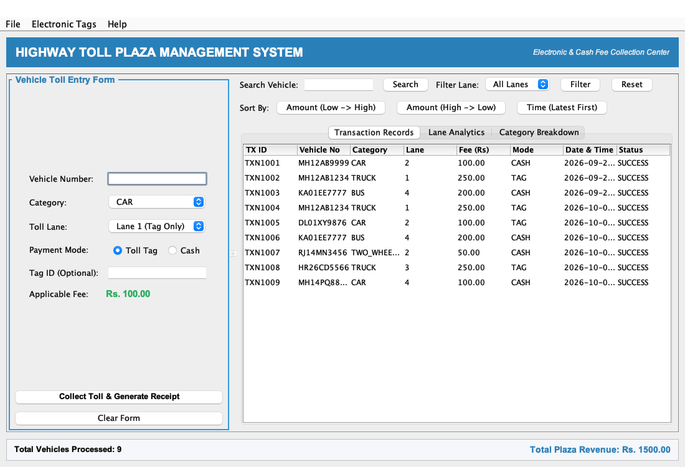
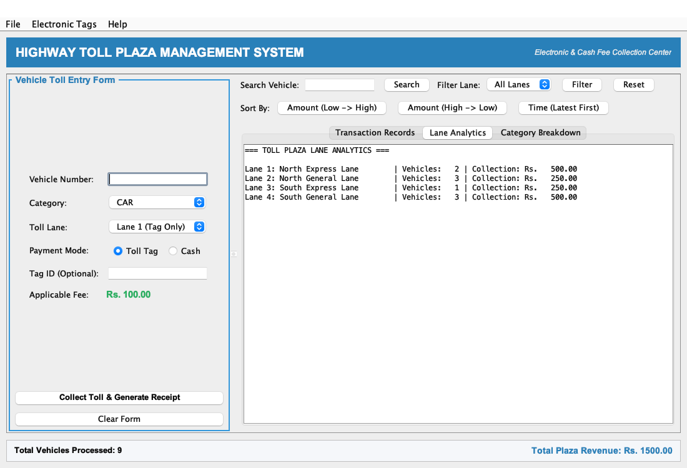
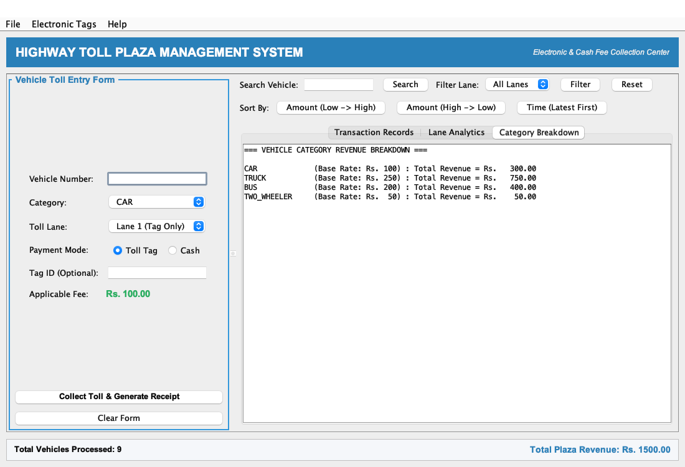
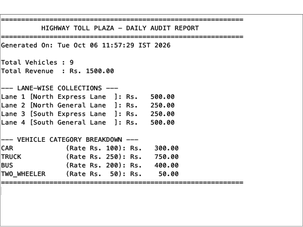
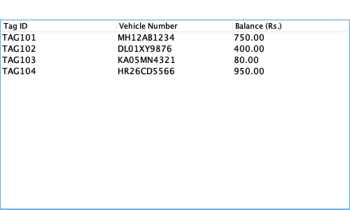

# 🛣️ Toll Plaza Fee Collection & Management System
> **Advanced Java Programming — Case Study 87**  
> A complete desktop-based Toll Management System built with **Core Java (JDK 8+)** and **Java Swing**, implementing full Object-Oriented design, Java Collections, dual payment handling (Cash & FASTag), and file stream persistence.

---

## 📌 Problem Statement
A highway toll plaza requires an automated software solution to manage vehicle classifications, calculate toll rates dynamically, track multi-lane traffic flow, support electronic toll tags (FASTag) alongside cash payments, and reconcile daily collections through persistent audit logs.

### Objectives
- Maintain vehicle category and toll rate information (`CAR`, `TRUCK`, `BUS`, `TWO_WHEELER`).
- Calculate toll fees automatically based on category base rates.
- Maintain sequential vehicle passage histories per lane using `LinkedList`.
- Support electronic FASTag prepaid balance deduction and Cash handling.
- Enable high-speed vehicle search (`HashMap`), lane filtering, and sorting (`TreeMap` and `Comparator`).
- Deliver an interactive, responsive desktop GUI using Java Swing.
- Persist all transactions to disk (`toll_transactions.txt`) using Character Streams.

---

## 📸 Application Screenshots

### 1. Main Dashboard & Transaction Management

*Figure 1: Toll entry form with live fee calculation, FASTag/Cash mode switcher, real-time transaction table, search/sort toolbar, and summary banner.*

---

### 2. Multi-Lane Traffic Analytics

*Figure 2: Real-time per-lane vehicle volume and revenue distribution backed by individual `LinkedList<Transaction>` lane histories.*

---

### 3. Vehicle Category Revenue Breakdown

*Figure 3: Fleet analytics breaking down transaction counts and financial shares across CAR, TRUCK, BUS, and TWO_WHEELER categories.*

---

### 4. Daily Audit & Reconciliation Dialog
<p align="center">
  
  
</p>
*Figure 4 & 5: Formatted daily audit report dialog and the prepaid FASTag wallet database view.*

---

## 🧠 Java & OOP Concepts Mapping

Every syllabus concept is mapped directly to functional code in this repository:

| Java Concept | Application in Problem Statement | Implementation Details |
| :--- | :--- | :--- |
| **Classes & Objects** | Real-world domain entities | `Vehicle`, `StandardVehicle`, `TollTag`, `TollLane`, `Transaction` |
| **Constructors** | Object initialization | Single, purposeful parameterized constructors across all models |
| **Enum** | Type-safe vehicle classification | `VehicleCategory` (`CAR: 100`, `TRUCK: 250`, `BUS: 200`, `TWO_WHEELER: 50`) |
| **Wrapper Classes** | Generics and fee calculations | `Double tollAmount`, `Integer laneNumber` in `Transaction` |
| **ArrayList** | Primary transaction storage | `ArrayList<Transaction> transactionList` bound to `JTable` |
| **LinkedList** | Lane-wise chronological sequence | `LinkedList<Transaction>` maintained inside each `TollLane` |
| **HashMap** | Vehicle registration lookup | `HashMap<String, ArrayList<Transaction>>` for $O(1)$ search |
| **TreeMap** | Natural fee-sorted index | `TreeMap<Double, ArrayList<Transaction>>` automatically sorted by fee |
| **CRUD Operations** | Transaction record management | Create (`processToll`), Read (`getAllTransactions`), Update, Delete |
| **Searching** | Vehicle and lane search | Hash lookup by plate number + linear filtering by lane |
| **Sorting** | Amount and timestamp ordering | `Comparable` natural sorting + `Comparator` for high-to-low and recency |
| **Exception Handling**| Negative testing & fault tolerance | Custom checked exceptions: `InvalidVehicleException`, `InvalidPaymentException` |
| **Validation** | Input sanitization | `Validator.java` checking plate format, positive amounts, and modes |
| **File I/O** | Persistent storage | `BufferedReader` & `BufferedWriter` reading/writing `toll_transactions.txt` |
| **Java Swing GUI** | Desktop operator interface | `JFrame`, `JSplitPane`, `JTabbedPane`, `JTable`, `JOptionPane`, `GridBagLayout` |
| **Multithreading** | Thread-safe GUI launching | `SwingUtilities.invokeLater()` binding execution to the EDT |

---

## 🏗️ Software Architecture

```
Java-project/
├── src/
│   └── com/
│       └── tollplaza/
│           ├── Main.java                          # Application entry point (EDT launcher)
│           ├── model/
│           │   ├── VehicleCategory.java           # Enum with embedded base rates
│           │   ├── Vehicle.java                   # Abstract base class
│           │   ├── StandardVehicle.java           # Concrete subclass of Vehicle
│           │   ├── TollTag.java                   # Prepaid electronic FASTag model
│           │   ├── TollLane.java                  # Toll lane maintaining LinkedList history
│           │   └── Transaction.java               # Comparable transaction entity
│           ├── exception/
│           │   ├── InvalidVehicleException.java   # Checked exception for invalid vehicle data
│           │   └── InvalidPaymentException.java   # Checked exception for payment/balance errors
│           ├── service/
│           │   ├── TollService.java               # Business logic, Collections, CRUD & File I/O
│           │   └── Validator.java                 # Static input validation routines
│           └── gui/
│               └── TollPlazaGUI.java              # Swing desktop GUI interface
├── screenshots/                                   # High-resolution application screenshots
├── toll_transactions.txt                          # Persistent transaction data store
├── Submission_Report.md                           # Comprehensive markdown submission document
└── Toll_Plaza_Submission_Report.pdf               # Print-ready academic submission report
```

---

## 🚀 How to Compile and Run

### Prerequisites
- Java Development Kit (JDK 8 or higher) installed
- Terminal or Command Prompt

### 1. Compile
From the project root directory, run:
```bash
javac -d bin src/com/tollplaza/model/*.java \
             src/com/tollplaza/exception/*.java \
             src/com/tollplaza/service/*.java \
             src/com/tollplaza/gui/*.java \
             src/com/tollplaza/Main.java
```

### 2. Run
```bash
java -cp bin com.tollplaza.Main
```

---

## 🧪 Pre-Loaded Test FASTags

The system comes pre-configured with sample FASTag accounts for testing:

| Tag ID | Linked Vehicle Number | Starting Balance | Suggested Test Scenario |
| :--- | :--- | :--- | :--- |
| `TAG101` | `MH12AB1234` | Rs. 1000.00 | Normal express lane deduction |
| `TAG102` | `DL01XY9876` | Rs. 500.00 | Standard vehicle passage |
| `TAG103` | `KA05MN4321` | Rs. 80.00 | Low balance test (select TRUCK / Rs. 250 to test exception) |
| `TAG104` | `HR26CD5566` | Rs. 1200.00 | Heavy commercial vehicle transit |

---

## 📄 Deliverables
- **Codebase:** Modular, student-friendly Java source files located in `src/`.
- **Submission Document:** [Submission_Report.md](Submission_Report.md) detailed report.
- **Formal PDF Report:** [Toll_Plaza_Submission_Report.pdf](Toll_Plaza_Submission_Report.pdf) with academic cover page, architecture diagrams, and screenshot walkthroughs.
